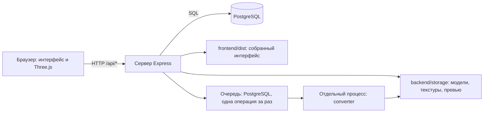

# Архитектура 3D Каталога

Приложение хранит модели внутри команд. Интерфейс работает в браузере, сервер
проверяет запросы и права, PostgreSQL хранит сведения, а файловое хранилище —
модели и текстуры. Этот документ описывает текущий код; будущие функции отмечены
в разделе ограничений.

Краткое описание находится в [README](../README.md), установка и команды запуска —
в [RUNNING](RUNNING.md),
оформление — в [DESIGN](DESIGN.md).
Все пути ниже указаны от корня проекта.

## Части приложения

| Путь | Назначение |
|---|---|
| [frontend/pages](../frontend/pages) | HTML-страницы; каждая подключает свой TypeScript-файл |
| [frontend/src/modules](../frontend/src/modules) | Код экранов, запросов и элементов шести разделов |
| [frontend/src/shared](../frontend/src/shared) | Общий интерфейс, HTTP-клиент, состояние пользователя, настройки и стили |
| [frontend/public/site-settings.js](../frontend/public/site-settings.js) | Применение настроек до показа страницы |
| [frontend/vite.config.ts](../frontend/vite.config.ts) | Сборка HTML-страниц, псевдонимы импортов и прокси запросов |
| [backend/src/server.ts](../backend/src/server.ts) | Запуск сервера, проверка связи с БД и периодическая очистка сеансов |
| [backend/src/app.ts](../backend/src/app.ts) | Подключение маршрутов, выдача интерфейса и обработка ошибок |
| [backend/src/db.ts](../backend/src/db.ts) | Подключение к PostgreSQL и выполнение транзакций |
| [backend/src/validation.ts](../backend/src/validation.ts) | Общие проверки идентификаторов, текста и почты для серверных модулей |
| [backend/src/storage.ts](../backend/src/storage.ts) | Создание и удаление папок моделей, проверка путей в хранилище |
| [backend/src/middleware](../backend/src/middleware) | Проверка входа и ролей, журналирование запросов |
| [backend/schema.sql](../backend/schema.sql) | 18 таблиц, связи, ограничения и индексы |
| [converter](../converter/README.md) | Самостоятельный модуль на JavaScript: преобразование OBJ ↔ GLB |
| [docker](../docker) | Dockerfile, конфигурация Compose и исключения сборки |

При разработке Vite работает на порту `5173` и пересылает `/api/*` серверу на
`3000`. После сборки Express выдаёт `frontend/dist`. По умолчанию сервер слушает
`localhost`; переменная `HOST` позволяет изменить адрес прослушивания.

## Запуск в Docker

[Compose](../docker/compose.yaml) запускает два сервиса: `app` и `db`.
В `app` работают Express и очередь конвертации; интерфейс собирается Vite при
создании образа. Chromium и ONNX Runtime входят в образ приложения.
`db` использует PostgreSQL 17 и применяет схему при первом запуске с пустым томом.
Приложение запускается после готовности базы.

Именованные тома `database`, `storage` и `logs` сохраняют базу, модели и журналы
после пересоздания контейнеров. Они не являются резервными копиями. Порт сайта
публикуется только на `127.0.0.1`; порт PostgreSQL не публикуется.
В контейнере сервер слушает `0.0.0.0`, чтобы принимать запросы через Docker.

Корневой `.env` задаёт `COMPOSE_FILE=docker/compose.yaml`, `POSTGRES_PASSWORD`
и `APP_PORT`. Он не входит в Git; [шаблон](../.env.example) содержит только примеры.
Файл `backend/.env` нужен для запуска без Docker и не используется контейнером.
Подготовленная модель `backend/storage/ai/general-x4v3.onnx` подключается в
`/opt/ai` только для чтения. Без неё обычная конвертация остаётся доступной.

## Шесть модулей

Во фронтенде и бэкенде используются одинаковые названия разделов.

| Модуль | За что отвечает | Основные серверные файлы |
|---|---|---|
| `accounts` | Вход, регистрация, сеансы, команды, роли и приглашения | [routes.ts](../backend/src/modules/accounts/routes.ts), [team-routes.ts](../backend/src/modules/accounts/team-routes.ts) |
| `upload` | Приём файлов, ZIP, разбор форматов, новые версии и сохранение превью | [routes.ts](../backend/src/modules/upload/routes.ts), [service.ts](../backend/src/modules/upload/service.ts) |
| `catalog` | Список моделей, поиск, карточка, скачивание и коллекции | [catalog-routes.ts](../backend/src/modules/catalog/catalog-routes.ts), [model-routes.ts](../backend/src/modules/catalog/model-routes.ts), [collection-routes.ts](../backend/src/modules/catalog/collection-routes.ts) |
| `conversion` | Создание, выполнение, просмотр и отмена операций в очереди | [routes.ts](../backend/src/modules/conversion/routes.ts), [queue.ts](../backend/src/modules/conversion/queue.ts), [process-file.js](../backend/src/modules/conversion/process-file.js) |
| `quality` | Получение сохранённых отчётов качества | [routes.ts](../backend/src/modules/quality/routes.ts) |
| `admin` | Журнал и сводка команды, системная статистика и блокировки | [routes.ts](../backend/src/modules/admin/routes.ts), [repository.ts](../backend/src/modules/admin/repository.ts) |

На сервере `routes.ts` принимает HTTP-запросы и отправляет ответы,
`service.ts` содержит сценарии и правила, `repository.ts` — SQL-запросы.
Отдельные `service` и `repository` есть там, где они выделены в коде: например,
в `accounts` и `upload`. В `quality`, `conversion` и коллекциях часть SQL находится
непосредственно в маршрутах.

Во фронтенде `modules/*/pages/*.ts` собирают экраны, `api.ts` содержит запросы
раздела, `components/` — его элементы. Повторно используемый код находится в
`shared/`. Непустые `modules/*/index.ts` задают точки доступа между модулями:
например, каталог подключает отчёт качества и окно новой версии.
В `accounts/pages/invite.ts` есть отдельный прямой запрос `/api/me` для проверки,
вошёл ли посетитель; остальные обычные запросы проходят через функции `api.ts`.

## Вход и права доступа

[passwords.ts](../backend/src/modules/accounts/passwords.ts) использует scrypt и
индивидуальную соль. При входе сервер создаёт случайный токен сеанса и отправляет
его в cookie с `HttpOnly`, `Secure`, `SameSite=Lax`. В `sessions` сохраняется
SHA-256-отпечаток токена и срок действия. Сеанс рассчитан на семь дней.

[requireAuth](../backend/src/middleware/auth.ts) проверяет cookie, срок сеанса и
блокировку пользователя. [requireTeamRole](../backend/src/middleware/team-access.ts)
проверяет членство, роль и блокировку команды. Посторонний получает `404`,
недостаточная роль или заблокированная команда — `403`.

| Действие | Наблюдатель | Участник | Владелец |
|---|---|---|---|
| Просмотр каталога, карточки, 3D и скачивание | Да | Да | Да |
| Загрузка моделей и создание заданий | Нет | Да | Да |
| Описание, теги, новая версия и превью | Нет | Для своих моделей | Для любых моделей команды |
| Изменение коллекций | Нет | Да | Да |
| Удаление моделей, управление участниками, журнал и сводка | Нет | Нет | Да |

Системный администратор блокирует пользователей и команды, видит статистику.
Его статус сам по себе не открывает чужие модели: для них требуется членство
в команде. Сайт скрывает недоступные кнопки через
[shared/session.ts](../frontend/src/shared/session.ts), но решение о доступе
всегда принимает сервер.

Смена ролей и выход из команды не допускают удаления последнего владельца;
изменения выполняются в транзакции с блокировкой строки команды. При принятии
приглашения блокируется его запись. Отпечатки сеансов, пароли и содержимое
запросов не записываются в журнал запросов.

## Модели и файлы

Загрузка принимает OBJ, STL, PLY, glTF, GLB и ZIP, до 100 МиБ входного файла.
Проверка прав выполняется перед приёмом файла. В ZIP допускаются до 1000 файлов
и до 500 МиБ распакованного содержимого; файлы сохраняются под служебными именами.

[archive.ts](../backend/src/modules/upload/archive.ts) выбирает основной файл и
находит связанные данные, [parsers](../backend/src/modules/upload/parsers)
определяют геометрию, материалы, скелет и текстуры. `upload/service.ts`
вычисляет SHA-256 основного файла, проверяет повторы внутри команды, сохраняет
файлы и записывает сведения в БД. Перед записью проверка повтора повторяется
в транзакции с блокировкой команды. При ошибке записи созданная папка удаляется.

В базе хранятся пути к файлам. Таблица `models` описывает карточку,
`model_versions` — её версии и характеристики, `files`, `textures`, `materials` —
содержимое версии. Текущая версия определяется по максимальному номеру.
При добавлении новой версии прежние файлы сохраняются, автоматические теги
пересчитываются, ручные остаются. Превью рисует браузер через Three.js.

Один исходный файл скачивается напрямую. Версия с сопутствующими файлами
скачивается ZIP-архивом с сохранением имён и папок. При удалении модели удаляются
записи и папки её версий, запись о действии остаётся в журнале команды.
При удалении коллекции модели сохраняются.

## Журналы и данные для показа

[logger.ts](../backend/src/logger.ts) пишет события в терминал и
`backend/logs/<дата>.log`. Уровни: `INFO`, `WARN`, `ERROR`.
[request-log.ts](../backend/src/middleware/request-log.ts) записывает метод,
путь без параметров запроса, код ответа, время обработки и пользователя.
В режиме разработки HTTP-клиент также выводит запросы в консоль браузера.
Входы и действия команды хранятся отдельно в `action_log`; журнал команды
включает входы её текущих участников, выполненные после вступления.

Демонстрационные пользователи, модели и их характеристики создаются через
[seed-demo](../backend/src/seed-demo). Оценки похожести, отчёты, состояния
подготовленных заданий и текстуры «после» заданы заранее. Как запускать показ
и назначать администратора, описано в [README](../README.md).

## Текущие ограничения

| Область | Ограничение |
|---|---|
| Конвертер | Только OBJ и GLB; анимации, морфинг и расширения glTF не переносятся |
| Очередь | Одна операция за раз; отменить можно только ожидающую операцию |
| Ресурсы | До 2 минут, 512 МиБ памяти V8 и 500 МиБ результата; память Chromium учитывается отдельно |
| Загрузка | Разбор большого файла может задерживать другие запросы |
| Учётные записи | Нет ограничения попыток входа, подтверждения почты и отправки приглашений письмами |
| Просмотр | Превью зависит от браузера; для STL и PLY может потребоваться настройка ориентации |
| Версии | Автор версии отдельно не хранится; действия записываются в журнал |
| Развёртывание | Внешний доступ требует настройки сети и HTTPS; автоматических резервных копий и загрузки по ссылке Roblox нет |

Для восстановления базу и файлы моделей нужно сохранять вместе.

## Очередь и отчёт качества

Очередь запускается вместе с сервером; блокировка PostgreSQL допускает одного
исполнителя. Прерванные операции повторяются после перезапуска. Перед публикацией
результата проверяются права доступа и контрольные суммы исходных файлов.

- Структурный отчёт сравнивает геометрию, границы, UV, текстуры и скелет.
- Chromium и Three.js создают изображения с шести сторон; вариант RGB SSIM
  рассчитывает похожесть. Оценка ниже 80 % требует ручной проверки.
- При недоступности рендеринга сохраняются результат и структурный отчёт,
  без процента похожести. Старые операции автоматически не пересчитываются.
- `report.json` и снимки хранятся рядом с результатом, выдаются с проверкой доступа
  и удаляются вместе с моделью. Итоги записываются в `quality_checks` и `quality_issues`.

Оценка изображений не гарантирует сохранность всех данных модели.
Реализация: [queue.ts](../backend/src/modules/conversion/queue.ts),
[render.js](../backend/src/modules/quality/render.js),
[image-score.js](../backend/src/modules/quality/image-score.js).

## Увеличение цветовых текстур

Сервер использует Real-ESRGAN General x4v3 через ONNX Runtime на CPU.
Опция работает при конвертации и без смены формата; исходные файлы сохраняются.

| Параметр | Значение |
|---|---|
| Увеличение | ×4 для базовых цветовых текстур; служебные карты не изменяются |
| Вход | До 1024 × 1024 на текстуру и 1 048 576 пикселей суммарно |
| Время | До 75 секунд в пределах общего лимита операции |
| Пропуск или ошибка | Превышение размеров отмечается в отчёте; ошибка обработки завершает операцию ошибкой |
| Результат | Текстуры в OBJ/GLB и пары PNG «до/после» в отчёте |

Модель проверяется по SHA-256; лицензия хранится рядом с весами.
ИИ может изменять детали, а похожесть после увеличения может снизиться.
[Подготовка модели](RUNNING.md#модель-увеличения-текстур),
[обработка текстур](../backend/src/modules/conversion/upscale.js).
