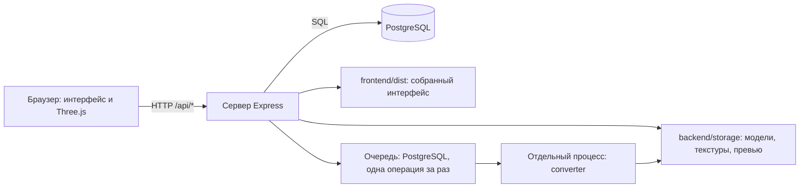

# Архитектура 3D Каталога

Приложение хранит модели внутри команд. Интерфейс работает в браузере, сервер
проверяет запросы и права, PostgreSQL хранит сведения, а файловое хранилище —
модели и текстуры. Этот документ описывает текущий код; будущие функции отмечены
в разделе ограничений.

Установка и команды запуска находятся в [README](../README.md),
оформление — в [DESIGN](DESIGN.md).
Все пути ниже указаны от корня проекта.

## Части приложения

| Путь | Назначение |
|---|---|
| [frontend/pages](../frontend/pages) | HTML-страницы; каждая подключает свой TypeScript-файл |
| [frontend/src/modules](../frontend/src/modules) | Код экранов, запросов и элементов шести разделов |
| [frontend/src/shared](../frontend/src/shared) | Общий интерфейс, HTTP-клиент, состояние пользователя, настройки и стили |
| [frontend/public/site-settings.js](../frontend/public/site-settings.js) | Применение настроек до показа страницы |
| [frontend/vite.config.ts](../frontend/vite.config.ts) | Сборка HTML-страниц, псевдонимы импортов и прокси запросов |
| [backend/src/server.ts](../backend/src/server.ts) | Запуск сервера, проверка связи с БД и периодическая очистка сеансов |
| [backend/src/app.ts](../backend/src/app.ts) | Подключение маршрутов, выдача интерфейса и обработка ошибок |
| [backend/src/db.ts](../backend/src/db.ts) | Подключение к PostgreSQL и выполнение транзакций |
| [backend/src/validation.ts](../backend/src/validation.ts) | Общие проверки идентификаторов, текста и почты для серверных модулей |
| [backend/src/storage.ts](../backend/src/storage.ts) | Создание и удаление папок моделей, проверка путей в хранилище |
| [backend/src/middleware](../backend/src/middleware) | Проверка входа и ролей, журналирование запросов |
| [backend/schema.sql](../backend/schema.sql) | 18 таблиц, связи, ограничения и индексы |
| [converter](../converter/README.md) | Самостоятельный модуль на JavaScript: преобразование OBJ ↔ GLB |

При разработке Vite работает на порту `5173` и пересылает `/api/*` серверу на
`3000`. После сборки Express выдаёт `frontend/dist`. Сервер привязан к `localhost`.

## Шесть модулей

Во фронтенде и бэкенде используются одинаковые названия разделов.

| Модуль | За что отвечает | Основные серверные файлы |
|---|---|---|
| `accounts` | Вход, регистрация, сеансы, команды, роли и приглашения | [routes.ts](../backend/src/modules/accounts/routes.ts), [team-routes.ts](../backend/src/modules/accounts/team-routes.ts) |
| `upload` | Приём файлов, ZIP, разбор форматов, новые версии и сохранение превью | [routes.ts](../backend/src/modules/upload/routes.ts), [service.ts](../backend/src/modules/upload/service.ts) |
| `catalog` | Список моделей, поиск, карточка, скачивание и коллекции | [catalog-routes.ts](../backend/src/modules/catalog/catalog-routes.ts), [model-routes.ts](../backend/src/modules/catalog/model-routes.ts), [collection-routes.ts](../backend/src/modules/catalog/collection-routes.ts) |
| `conversion` | Создание, выполнение, просмотр и отмена операций в очереди | [routes.ts](../backend/src/modules/conversion/routes.ts), [queue.ts](../backend/src/modules/conversion/queue.ts), [process-file.js](../backend/src/modules/conversion/process-file.js) |
| `quality` | Получение сохранённых отчётов качества | [routes.ts](../backend/src/modules/quality/routes.ts) |
| `admin` | Журнал и сводка команды, системная статистика и блокировки | [routes.ts](../backend/src/modules/admin/routes.ts), [repository.ts](../backend/src/modules/admin/repository.ts) |

На сервере `routes.ts` принимает HTTP-запросы и отправляет ответы,
`service.ts` содержит сценарии и правила, `repository.ts` — SQL-запросы.
Отдельные `service` и `repository` есть там, где они выделены в коде: например,
в `accounts` и `upload`. В `quality`, `conversion` и коллекциях часть SQL находится
непосредственно в маршрутах.

Во фронтенде `modules/*/pages/*.ts` собирают экраны, `api.ts` содержит запросы
раздела, `components/` — его элементы. Повторно используемый код находится в
`shared/`. Непустые `modules/*/index.ts` задают точки доступа между модулями:
например, каталог подключает отчёт качества и окно новой версии.
В `accounts/pages/invite.ts` есть отдельный прямой запрос `/api/me` для проверки,
вошёл ли посетитель; остальные обычные запросы проходят через функции `api.ts`.

## Вход и права доступа

[passwords.ts](../backend/src/modules/accounts/passwords.ts) использует scrypt и
индивидуальную соль. При входе сервер создаёт случайный токен сеанса и отправляет
его в cookie с `HttpOnly`, `Secure`, `SameSite=Lax`. В `sessions` сохраняется
SHA-256-отпечаток токена и срок действия. Сеанс рассчитан на семь дней.

[requireAuth](../backend/src/middleware/auth.ts) проверяет cookie, срок сеанса и
блокировку пользователя. [requireTeamRole](../backend/src/middleware/team-access.ts)
проверяет членство, роль и блокировку команды. Посторонний получает `404`,
недостаточная роль или заблокированная команда — `403`.

| Действие | Наблюдатель | Участник | Владелец |
|---|---|---|---|
| Просмотр каталога, карточки, 3D и скачивание | Да | Да | Да |
| Загрузка моделей и создание заданий | Нет | Да | Да |
| Описание, теги, новая версия и превью | Нет | Для своих моделей | Для любых моделей команды |
| Изменение коллекций | Нет | Да | Да |
| Удаление моделей, управление участниками, журнал и сводка | Нет | Нет | Да |

Системный администратор блокирует пользователей и команды, видит статистику.
Его статус сам по себе не открывает чужие модели: для них требуется членство
в команде. Сайт скрывает недоступные кнопки через
[shared/session.ts](../frontend/src/shared/session.ts), но решение о доступе
всегда принимает сервер.

Смена ролей и выход из команды не допускают удаления последнего владельца;
изменения выполняются в транзакции с блокировкой строки команды. При принятии
приглашения блокируется его запись. Отпечатки сеансов, пароли и содержимое
запросов не записываются в журнал запросов.

## Модели и файлы

Загрузка принимает OBJ, STL, PLY, glTF, GLB и ZIP, до 100 МиБ входного файла.
Проверка прав выполняется перед приёмом файла. В ZIP допускаются до 1000 файлов
и до 500 МиБ распакованного содержимого; файлы сохраняются под служебными именами.

[archive.ts](../backend/src/modules/upload/archive.ts) выбирает основной файл и
находит связанные данные, [parsers](../backend/src/modules/upload/parsers)
определяют геометрию, материалы, скелет и текстуры. `upload/service.ts`
вычисляет SHA-256 основного файла, проверяет повторы внутри команды, сохраняет
файлы и записывает сведения в БД. Перед записью проверка повтора повторяется
в транзакции с блокировкой команды. При ошибке записи созданная папка удаляется.

В базе хранятся пути к файлам. Таблица `models` описывает карточку,
`model_versions` — её версии и характеристики, `files`, `textures`, `materials` —
содержимое версии. Текущая версия определяется по максимальному номеру.
При добавлении новой версии прежние файлы сохраняются, автоматические теги
пересчитываются, ручные остаются. Превью рисует браузер через Three.js.

Один исходный файл скачивается напрямую. Версия с сопутствующими файлами
скачивается ZIP-архивом с сохранением имён и папок. При удалении модели удаляются
записи и папки её версий, запись о действии остаётся в журнале команды.
При удалении коллекции модели сохраняются.

## Журналы и данные для показа

[logger.ts](../backend/src/logger.ts) пишет события в терминал и
`backend/logs/<дата>.log`. Уровни: `INFO`, `WARN`, `ERROR`.
[request-log.ts](../backend/src/middleware/request-log.ts) записывает метод,
путь без параметров запроса, код ответа, время обработки и пользователя.
В режиме разработки HTTP-клиент также выводит запросы в консоль браузера.
Входы и действия команды хранятся отдельно в `action_log`; журнал команды
включает входы её текущих участников, выполненные после вступления.

Демонстрационные пользователи, модели и их характеристики создаются через
[seed-demo](../backend/src/seed-demo). Оценки похожести, отчёты, состояния
подготовленных заданий и текстуры «после» заданы заранее. Как запускать показ
и назначать администратора, описано в [README](../README.md).

## Текущие ограничения

- После конвертации выполняются структурная проверка и визуальное сравнение шести ракурсов. Структурная проверка сравнивает количество треугольников, границы и наличие UV, базовой текстуры и скелета; число вершин и сеток показывается справочно. Отдельной опцией доступно нейросетевое увеличение цветовых текстур. Отменить можно только операцию в очереди. GLB поддерживается без расширений glTF и морфинга; анимации не переносятся.
- Загрузка по ссылке Roblox, Docker-запуск и автоматическое ежедневное резервирование не реализованы в этом проекте. Базу и `backend/storage/` нужно сохранять вместе.
- Разбор при загрузке выполняется в процессе сервера: большой файл может задержать другие запросы. Сама конвертация вынесена в дочерний процесс с лимитом памяти V8 512 МБ и времени 2 минуты; результат ограничен 500 МБ.
- Нет ограничения попыток входа, подтверждения почты и отправки приглашений письмами. Приглашения доступны в интерфейсе и по ссылке.
- Создание превью зависит от браузера. При неудаче показывается значок; автор с ролью участника или владелец может повторить создание через карточку.
- В истории версий нет отдельного поля автора версии; сведения о действии записываются в журнал. STL и PLY не задают направление оси вверх, поэтому ориентация может потребовать проверки.
- Для доступа с других компьютеров нужны настройка адреса прослушивания и HTTPS. Полной мобильной адаптации нет.

Очередь запускается вместе с сервером. Блокировка PostgreSQL допускает одного
исполнителя, даже если запущено несколько экземпляров сервера. После остановки
прерванные операции возвращаются в очередь. Исходные файлы копируются во временную
папку с проверкой контрольных сумм; результат публикуется после повторной проверки
прав. Файл результата и `report.json` с предупреждениями хранятся внутри папки версии
и удаляются вместе с моделью. `report.json` также содержит измеренные показатели
до и после преобразования и расхождения. Порог для границ — 0,00001 от максимума
между единицей и размером исходной модели. Структурная проверка не сравнивает
изображения и не гарантирует совпадения формы каждой поверхности или материалов.

Визуальная часть запускает Chromium через Playwright внутри дочернего процесса
конвертации. Three.js читает исходный файл и результат с их материалами и текстурами.
Используются шесть направлений (спереди, сзади, слева, справа, сверху, снизу),
384×384 пикселя, одинаковые свет, камера и масштаб по границам исходной модели.
Проигрывание анимаций отключено. Ресурсы подаются из временной папки операции;
сетевые запросы к другим адресам блокируются.

Показатель — вариант RGB SSIM: неперекрывающиеся окна 8×8 с равными весами,
константы C1=6,5025 и C2=58,5225 для 8-битных каналов. Альфа компонуется на фон
RGB(32,32,32). Окна, полностью пустые у обеих моделей, исключаются; затем усредняются
каналы, окна и ракурсы с видимой поверхностью. Значения ограничены 0–100 %;
порог ручной проверки — 80 %. Это мера выбранных изображений, а не гарантия
эквивалентности моделей и не эталонная реализация SSIM с гауссовым окном.

Двенадцать PNG хранятся рядом с результатом в `images/` и выдаются через API с
проверкой команды, модели и операции. Метаданные находятся в `report.json`.
Вычисленная оценка, признак ручной проверки и замечания записываются в существующие
таблицы `quality_checks`/`quality_issues` одной транзакцией с результатом операции;
каталог и статистика используют эти данные. Подробный отчёт отличает реальный расчёт
от демонстрационных записей.
При недоступности рендеринга результат конвертации остаётся доступен, но визуальный
процент не выставляется и операция требует проверки. Старые операции автоматически
не пересчитываются. На сервере нужны Chromium и поддержка WebGL; браузер использует
память отдельно от лимита V8 процесса конвертации.

## Увеличение цветовых текстур

При выбранной опции очередь передаёт модулю конвертации обработчик базовых текстур.
Сам `converter/` не зависит от ONNX Runtime или sharp. Обработчик сервера использует
General x4v3 (Real-ESRGAN) с шумоподавлением 0,5; файл ONNX воспроизводимо экспортируется
из закреплённых официальных весов скриптом `backend/scripts/prepare-upscale-model.py`.
Лицензия сохраняется рядом с весами. Модель проверяется по SHA-256 при запуске обработки.

На CPU используются 4 потока и фрагменты с ядром 128 пикселей и перекрытием 40.
Увеличение — 4×. Прозрачность масштабируется отдельно линейно. Одинаковые изображения
обрабатываются один раз; карты нормалей и другие служебные карты не изменяются.
Максимальный вход — 1024 по каждой стороне и суммарно 1 048 576 пикселей на операцию.
Большие текстуры пропускаются с причиной в отчёте. Обработка имеет собственный лимит
75 секунд, общий лимит дочернего процесса остаётся 2 минуты. При ошибке оригиналы
не меняются, операция завершается ошибкой.

Увеличенные изображения встраиваются в результат OBJ/GLB. Исходные и новые PNG для
сравнения хранятся в `textures/` рядом с результатом и выдаются только участникам
соответствующей команды. Метаданные находятся в `report.json`. Функция также допускает
обработку без смены формата. Отсутствие цветовых текстур и пропуски указаны в отчёте.
Сравнение внешнего вида выполняется уже с увеличенными текстурами; более низкая
похожесть в таком режиме может отражать намеренное изменение изображения.
